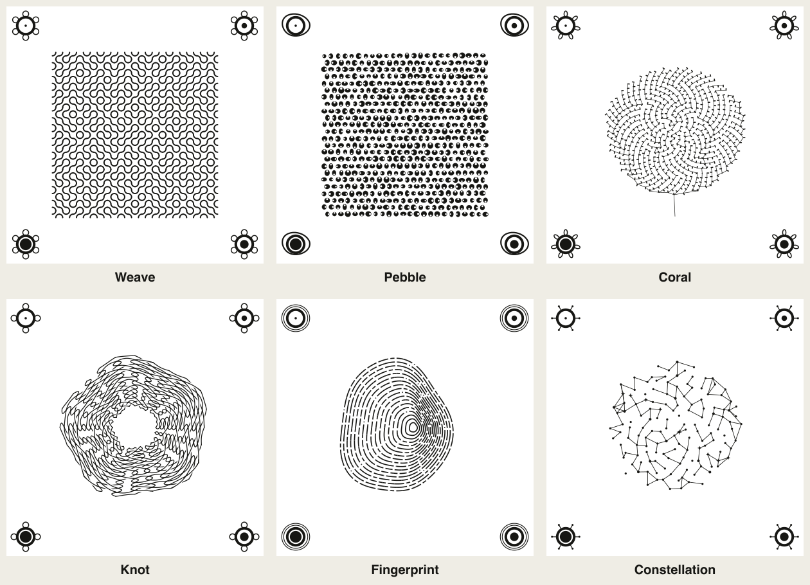

# SR Code lab · v6

Special Response (SR) Code is a browser-local generator and pixel reader for six optical styles. Each style uses features of its own artwork for alignment. The app exports PNG or SVG, reads images and camera frames, and supports multipart text and files. The reader also accepts v4 and v5 exports.



| Style | What carries the message |
|---|---|
| Weave | Two continuous curved yarn routes. |
| Pebble | Openings in near-round pebbles, with four regular stones sometimes merging into one larger stone. |
| Coral | Long and short ribs growing inward from a colony of coral cups. |
| Knot | The timing and over–under order of crossings along ropes threaded through a trefoil. |
| Fingerprint | Ridge forks and occasional openings. |
| Constellation | Star positions and selectable links with a 30° minimum junction angle. |

## Capacity trade-off

Net payload bytes after framing and **Strong** error correction:

| Language | S | M | L | XL | XL with Light |
|---|---:|---:|---:|---:|---:|
| Weave | 19 | 72 | 177 | 360 | 516 |
| Pebble | 62 | 168 | 378 | 746 | 1,063 |
| Coral | 19 | 34 | 52 | 72 | 112 |
| Knot | 19 | 34 | 52 | 72 | 112 |
| Fingerprint | 19 | 34 | 52 | 72 | 112 |
| Constellation | 19 | 34 | 52 | 72 | 112 |

UTF-8 characters may require several bytes. Up to 16 codes can carry a message. Capacities are implementation limits, not theoretical limits of these shapes. The organic designs intentionally trade capacity for appearance. Native widths are 968, 1,400, 1,976 and 2,696 pixels. These are export dimensions, not guaranteed scanning thresholds.

## Run

Node 22+, with `sharp` as a development-only dependency:

```sh
npm install
npm test
npm run benchmark
npm run build
npm run dev
```

Open http://127.0.0.1:4173. Camera access needs HTTPS or localhost. Files and camera frames stay on the device.

Make exports PNG/SVG, accepts text or arbitrary files, and supports multipart messages. Read accepts images or camera frames. Test this code provides cover, crop, rotation and blur controls. Compare shows actual capacities and measured outcomes, including failures.

## Deploy

GitHub Actions builds and publishes `dist/` to [sr.dexo.games](https://sr.dexo.games) on pushes to `main`. The workflow can also be run manually from `main` in the Actions tab. The Pages custom domain uses a DNS CNAME from `sr.dexo.games` to `dexogames.github.io`.

## Reading

The reader uses ordinary yarn loops, rounded stones, mature coral cups, trefoil windows, ridge lakes or four distinct celestial silhouettes to fit a projective transform. A visible page edge can help establish the initial pose. Ink and paper samples from the design calibrate the optical read. Reed–Solomon correction and checksum verification precede display.

The camera requests high resolution and continuous focus when available. It ranks three independent snapshots taken roughly 45 ms apart and tries the sharpest first. The last detected region guides sharpness scoring for up to 1.5 seconds. **Save frame** exports the attempted snapshot.

## Evaluation

`npm test` exercises all 96 full-capacity combinations, reflection, v4/v5 compatibility, obscured features, every allowed Constellation junction, moving snapshots and distorted captures. `npm run benchmark` regenerates the image report. `node scripts/webcam-benchmark.mjs` regenerates the camera report.

Small Constellation must recover full payloads from 360-pixel captures with rotation, 1-pixel Gaussian blur and 6% of the field covered at the same time. The suite exercises all four layouts and correction levels at six angles, with coverage over the centre or one of the four guides. Every style must also pass a small-format combined-damage check.

The comparison view reports three messages per style and condition, including failed reads. The camera tests simulate oblique prints with ink spread or ink loss. Physical printer and camera performance remains unmeasured.

See [the format specification](FORMAT.md), [image results](public/benchmark.json) and [camera results](public/webcam-benchmark.json).
